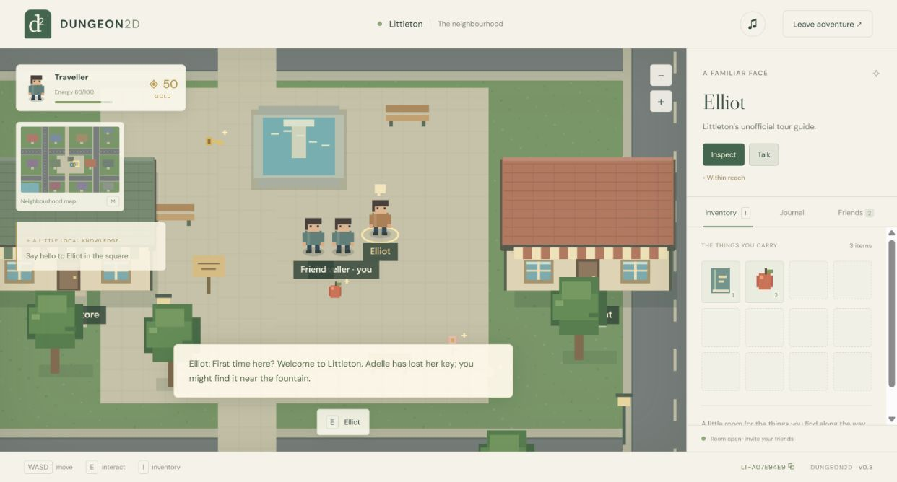

<!-- Last Modified: 2026-10-17 -->
# Littleton verification

The sample adventure contains 12 town venues, 13 maps across 2 linked metadata packs, seven item definitions per pack, residents, the lost-key quest, shops, cinema interaction, a bank and a fictional-currency casino game. `exports/littleton.dungeon` is the portable bundle.

## Automated checks

- `npm test`: 20 passing tests covering the bundled venues and return portals, walkable interior interactions, collisions and speed limits, shared item contention, drops, inventory effects, targeted tickets, quest reward idempotency, shop stock and pricing, bank/dice balances, linked-pack state preservation, player capacity, JSON transfer, connection identity spoofing, cleanup, ZIP round trips, missing references, invalid metadata and unsafe archives.
- `npm run build`: production bundle succeeds.
- `npm audit`: zero known vulnerabilities after updating the source-map dependency.
- `git diff --check`: clean.

## Browser checks

- Two browser tabs connected through the real PeerJS signalling service and WebRTC, with the complete town metadata transferred to the guest.
- Guest took the shared apple; guest inventory increased from 2 to 3 apples, and it disappeared from the host's world. Consuming it restored energy from 80 to 100.
- Room chat sent by the guest appeared in both players' Friends panels under the correct sender name.
- Host walked to Elliot, opened dialogue, tracked the General Store on the map, entered it and approached Mabel while the guest stayed in town.
- Buying coffee cost 8 gold (50 → 42) and reduced shared stock (10 → 9).
- Closing the host returned the guest to the main menu with an explicit explanation.
- The exported `.dungeon` file imported through the actual file picker successfully.
- Production preview loaded, started the casino directly from the selector and returned through its linked exit to Littleton with inventory intact; no browser errors were recorded.
- At 320×740 the game, touch controls and inventory/chat panel fit the viewport. A menu heading overflow found during testing was fixed; no horizontal overflow remained.
- The initial loading race and PeerJS JSON-channel message-size limit found during testing were fixed and rechecked.

## Practical limits

Session progress is intentionally temporary; imported packs, name, outfit and audio preference persist locally. There is no automatic host migration or session resume. Online play depends on signalling and reachable WebRTC routes; restrictive networks may need a configured TURN service. The supported room size is eight; live browser verification used two players. Pack schema v1 supports data-driven compositions of existing mechanics, not executable plugin code.
